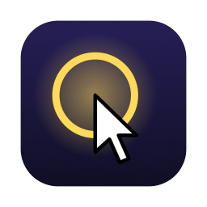
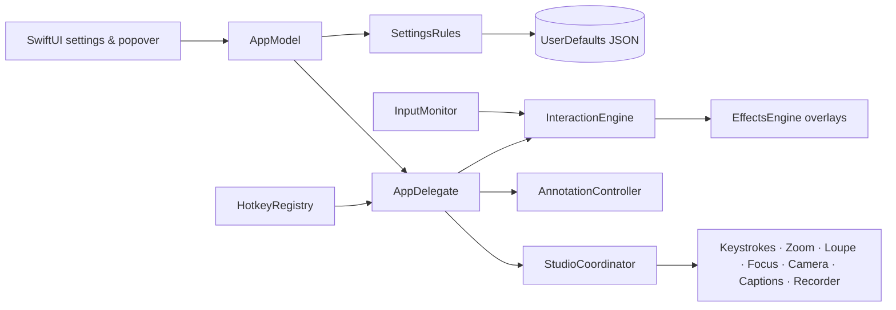

<div align="center">



# 🖱️ Mickey

**A menu-bar cursor highlighter and presentation toolkit for macOS.**


[](https://www.swift.org/)
[](https://www.apple.com/macos/)
[](https://developer.apple.com/xcode/swiftui/)
[](LICENSE)

</div>

**Mickey** makes your pointer impossible to miss during demos, lessons, meetings and screen recordings. It lives in the menu bar and adds a spotlight, a ring, click effects and sounds, a trail and shake-to-locate, then goes further with on-screen drawing, keystroke display, live zoom, a loupe, window focus, a webcam bubble, live captions and a screen recorder.

> [!NOTE]
> Mickey runs entirely on your Mac: no account, no network access, no analytics. Settings stay in your user defaults and recordings in your Movies folder.

## ✨ Features

### 🎯 Cursor effects

- **Spotlight**: dims the screen under the pointer except a circle, a horizontal band or a vertical band around it. It can stay on, appear only while a modifier is held (**Hold a Key to Show**), or switch itself off once the pointer moves away (**Turn Off When Moving**).
- **Ring**: a ring that follows the pointer, with size, thickness, color, neon glow and an optional pulse animation.
- **Click feedback**: seven effects (single ring, ripple, ring burst, color flash, particle burst, glow pulse, scale bounce) on mouse clicks, on a lone tap of a modifier key, or on demand with a hotkey.
- **Click sounds**: a built-in click or any audio file you choose, at the volume you set.
- **Trail**: solid, dots, dashed, particles, glow, stars or hearts, with length, width, opacity, color and fade speed.
- **Shake to locate**: shake the mouse and a large pointer flashes then shrinks back onto the real one (or a ring closes in on it).
- A master switch turns everything on or off: cursor effects, drawing, presenter tools and recording. Switching any of them on while Mickey is off turns Mickey on for you, so no toggle is ever dead.

### ✏️ Annotations

- Draw on top of everything: freehand, arrow, rectangle, circle, line, highlighter, text and numbered callouts.
- Hold **Fn (🌐)** (turn it off in the settings if Fn is used for something else) or optionally **Right Option** to draw while the key is held, or toggle a persistent drawing mode with a hotkey or the menu bar. Arrow keys and F-keys, which macOS reports with the Fn flag, never start drawing, and nothing draws while Mickey is off.
- A floating toolbar offers tools, colors, stroke width, undo, redo, copy as an image and clear; single-letter shortcuts (F, A, R, C, L, H, T, N), ⌘Z, ⇧⌘Z, ⌘⌫ and Esc work even while holding Fn.
- Optional auto-fade and clear-on-exit.

### 🎬 Presenter tools

| Tool | What it does | Permission |
| --- | --- | --- |
| ⌨️ **Keystrokes** | Shows the shortcuts you press in an on-screen bar, in one of five styles (classic, glass, keycaps, neon, minimal); repeats collapse into `×n`. **Shortcuts Only** (on by default) never shows plain typing. | Input Monitoring |
| 🔍 **Live Zoom** | Magnifies the whole screen (×1.25 to ×6) while the spot under the pointer stays put; move the pointer to pan. It glides in and out, and can zoom in around each click instead of staying on. | Screen Recording |
| 🔎 **Loupe** | A round or square magnifying glass that follows the pointer. | Screen Recording |
| 🪟 **Focus** | Dims everything except the frontmost window, following you as you switch apps. | — |
| 📷 **Camera bubble** | Your webcam in a draggable circle or rounded square, mirrored if you like. | Camera |
| 💬 **Captions** | Live subtitles of what you say, recognised on your Mac when the language supports it. | Microphone, Speech Recognition |
| ⏺️ **Recorder** | Records the screen under the pointer (or a region you drag), effects and annotations included, to `~/Movies/Mickey` after a countdown; quality (up to 4K) and frame rate (30 or 60) are adjustable, and it can be paused and resumed. | Screen Recording |

### 🧰 Everyday use

- **Menu-bar popover** with the master switch, the toggles you choose, each toggle's shortcut, presets, recording and drawing.
- **Presets**: *Presentation*, *Tutorial Video* and *Discreet* switch several effects at once while keeping your colors and sizes.
- **Automatic mode** applies a preset while Zoom, Teams, FaceTime, Keynote, PowerPoint, QuickTime Player, OBS, Loom, Webex or Discord runs, then restores your settings; each app can have its own preset, and the preset is never saved as your own settings.
- **Global hotkeys** for every action, with sensible defaults, a per-action restore button, *Reset to Defaults* and *Clear All*.
- **Conflict checks**: shortcuts already used by macOS or by another action are refused; your own app shortcuts and widely used app shortcuts get a warning.
- Launch at login, menu bar and/or Dock icon, adjustable update rate, searchable help, first-launch onboarding.
- **Languages**: English and French, following macOS; more can be added ([`docs/LOCALIZATION.md`](docs/LOCALIZATION.md)).
- **Accessibility**: honors *Reduce Motion*; controls are labelled for VoiceOver.
- **Backup**: export your settings to a JSON file and import them on another Mac.

## ⌨️ Default shortcuts

Every action defaults to **⌃⌥⌘** plus a letter, a combination macOS and most apps leave free.

| Shortcut | Action | Shortcut | Action |
| --- | --- | --- | --- |
| `⌃⌥⌘M` | Toggle Mickey | `⌃⌥⌘D` | Toggle drawing |
| `⌃⌥⌘S` | Toggle spotlight | `⌃⌥⌘Y` | Toggle keystrokes |
| `⌃⌥⌘R` | Toggle ring | `⌃⌥⌘Z` | Toggle live zoom |
| `⌃⌥⌘T` | Toggle trail | `⌃⌥⌘O` | Toggle loupe |
| `⌃⌥⌘C` | Toggle click feedback | `⌃⌥⌘W` | Toggle focus |
| `⌃⌥⌘K` | Toggle click sounds | `⌃⌥⌘E` | Toggle camera bubble |
| `⌃⌥⌘F` | Flash the click effect | `⌃⌥⌘A` | Toggle captions |
| `⌃⌥⌘L` | Toggle shake to locate | `⌃⌥⌘V` | Start / stop recording |
| `⌃⌥⌘P` | Pause / resume recording | | |

Letters follow your keyboard layout: on AZERTY, `⌃⌥⌘A` is the key marked A. On layouts without Latin letters (Russian, Greek, Arabic…) the defaults sit on the US key positions, and the drawing shortcuts (F, A, R…, ⌘Z, ⌘C) answer to those positions too. All of them can be changed or cleared in **Settings › Hotkeys**.

## 🔐 Permissions

Cursor effects, annotations and Focus need **no permission**: the pointer and modifier keys are read by polling, and clicks through global mouse monitors. The presenter tools ask only for what they use, and each settings page shows the permission state with a button to grant it.

| Permission | Used by | Why |
| --- | --- | --- |
| Input Monitoring | Keystrokes | Read which shortcuts are pressed. Text is never recorded. |
| Screen Recording | Live Zoom, Loupe, Recorder | Capture the screen to magnify or record it. |
| Camera | Camera bubble | Show the webcam. |
| Microphone, Speech Recognition | Captions | Hear and transcribe your voice. |

The app is sandboxed with only these entitlements: user-selected read-only files (custom click sound), Movies folder (recordings), camera and audio input. It has **no network entitlement**.

## 🧱 Technology stack

| Area | Technologies |
| --- | --- |
| Language | Swift 6 with strict concurrency, main-actor default isolation |
| User interface | SwiftUI (settings, popover, onboarding, HUDs), AppKit (status item, panels, overlays) |
| Rendering | Core Animation layers in click-through overlay panels, one per screen |
| Input | `CGEventSource` polling, `NSEvent` global monitors, Carbon hotkeys, listen-only `CGEventTap` |
| Capture and media | ScreenCaptureKit, AVFoundation (`AVAssetWriter`, `AVCaptureSession`), Speech |
| System | ServiceManagement (login item), StoreKit (review prompt), unified logging |
| Persistence | Versioned JSON document in `UserDefaults` with field-level recovery and migrations |
| Project | Swift Package (`MickeyKit`) + XcodeGen-generated app target |
| Testing | Swift Testing |

## 🏗️ Architecture



- **Single source of truth**: every change, whether it comes from a settings page, the popover or a hotkey, goes through `AppModel`, which applies the cross-field rules (master auto-enable, mutually exclusive spotlight triggers, menu bar or Dock always reachable) and saves with a short debounce.
- **Pure domain**: `MickeyDomain` holds the models, rules and algorithms (shake detection, trail buffer, tap and hold recognisers, zoom geometry, keystroke formatting…) without AppKit, so it is unit-tested directly.
- **Thin system adapters**: `MickeySystem` wraps input, hotkeys, login item, sound, permissions and window-server queries; `MickeyEffects`, `MickeyAnnotations` and `MickeyStudio` render; the app target only wires everything together.
- **Window levels** sit just below the cursor so effects stay above menus, the Dock and full-screen apps: focus, zoom, effects, drawing, then toolbars and HUDs. Zoom and loupe capture the screen without Mickey's own windows; the recorder keeps them, so effects appear in recordings.

More detail in [`docs/ARCHITECTURE.md`](docs/ARCHITECTURE.md), [`docs/LOCALIZATION.md`](docs/LOCALIZATION.md), [`docs/DATA_MODEL.md`](docs/DATA_MODEL.md) and [`docs/PRODUCT_SPEC.md`](docs/PRODUCT_SPEC.md).

## 📦 Prerequisites

- macOS 14 Sonoma or later;
- [Xcode](https://developer.apple.com/xcode/) 26 or later (Swift 6.2 toolchain);
- [XcodeGen](https://github.com/yonaskolb/XcodeGen) to generate the Xcode project.

```bash
xcodebuild -version
brew install xcodegen
```

## 🚀 Installation

### Homebrew

```bash
brew install arrows78/mickey/mickey
```

Use the full name: Homebrew 7 only loads casks from third-party taps you trust, and naming the tap in the command trusts that cask. If you ran `brew tap arrows78/mickey` first, run `brew trust --tap arrows78/mickey` before installing. Update with `brew upgrade --cask mickey`. The same Gatekeeper warning applies as for the download below.

### Download

Grab `Mickey-<version>.zip` from the [latest release](https://github.com/Arrows78/Mickey/releases/latest), unzip it and move **Mickey.app** to `/Applications`. Releases are universal (Apple Silicon and Intel).

> [!WARNING]
> Releases are signed ad hoc, not notarised, so macOS blocks the first launch. Open **System Settings › Privacy & Security** and click **Open Anyway**, or run `xattr -dr com.apple.quarantine /Applications/Mickey.app`.

### Build from source

#### 1. Clone the repository

```bash
git clone git@github.com:Arrows78/Mickey.git
cd Mickey
```

#### 2. Generate the Xcode project

```bash
xcodegen generate
```

`Mickey.xcodeproj` is generated from [`project.yml`](project.yml) and is not committed.

#### 3. Build and run

Open `Mickey.xcodeproj` in Xcode and run the **Mickey** scheme, or build from the command line:

```bash
xcodebuild -project Mickey.xcodeproj -scheme Mickey -configuration Release -derivedDataPath build/DerivedData build
ditto build/DerivedData/Build/Products/Release/Mickey.app /Applications/Mickey.app
open /Applications/Mickey.app
```

> [!TIP]
> Launch at login and the permission prompts behave best when Mickey runs from `/Applications`.

> [!NOTE]
> Builds are signed ad hoc for local use, with the bundle identifier `dev.local.mickey`. Set your own team and identifier in `project.yml` to distribute the app.

## 🛠️ Scripts

| Command | Description |
| --- | --- |
| `./scripts/ci.sh` | Runs the package tests, the localization check, regenerates the project and builds the app — the same checks to run before a commit. |
| `swift test --package-path Packages/MickeyKit` | Runs the unit tests only. |
| `swift scripts/make_app_icon.swift` | Redraws the app icon set from code. |
| `python3 scripts/make_click_sound.py` | Synthesises the default click sound (`App/Resources/click.wav`). |
| `python3 scripts/l10n.py sync` / `check` | Regenerates the English reference table / verifies every language ([`docs/LOCALIZATION.md`](docs/LOCALIZATION.md)). |
| `scripts/run_dev.sh` | Builds and launches an isolated copy (own bundle identifier, settings and permissions), so testing never touches the installed app's data. |
| `python3 scripts/release.py prepare` | Next version, version bump and changelog from the commit messages ([`docs/RELEASING.md`](docs/RELEASING.md)). |
| `scripts/render_cask.sh VERSION SHA256` | Prints the Homebrew cask of a release (used by the Release workflow). |

To publish a release (details in [`docs/RELEASING.md`](docs/RELEASING.md)):

1. `python3 scripts/release.py prepare`: picks the next version from the commit messages (Conventional Commits), bumps `project.yml` and `App/Info.plist`, and rewrites `CHANGELOG.md`. Add `--dry-run` to preview it.
2. Commit it (`chore(release): X.Y.Z`) and push the matching tag: `git tag vX.Y.Z && git push origin main vX.Y.Z`. The [Release workflow](.github/workflows/release.yml) checks the version and the changelog, runs the tests and the localization check, builds a universal app, attaches the zip to a new GitHub release (`0.x` versions are marked as pre-releases) and updates the Homebrew tap.
3. The release notes are the changelog section of the version, or `docs/releases/<version>.md` if you wrote one.

The tap is the `Arrows78/homebrew-mickey` repository. The workflow updates it when the `HOMEBREW_TAP_TOKEN` secret holds a fine-grained token with *Contents: read and write* on that repository; without it the release is still published and the tap is left alone. The cask template is `packaging/homebrew/mickey.rb.in`.

## 📂 Project structure

```text
Mickey/
├── project.yml                  # XcodeGen definition of the app target
├── App/
│   ├── Sources/                 # Composition root: AppDelegate, status item, windows, menu, review prompt
│   ├── Resources/               # Generated icon set, click sound and the languages (en.lproj, fr.lproj)
│   ├── Info.plist               # Generated from project.yml
│   └── Mickey.entitlements      # Generated from project.yml
├── Packages/MickeyKit/
│   ├── Sources/
│   │   ├── MickeyDomain/        # Models, rules and algorithms, no AppKit
│   │   ├── MickeyPersistence/   # JSON settings store, recovery and migrations
│   │   ├── MickeySystem/        # Input, hotkeys, login item, sound, permissions, window queries
│   │   ├── MickeyEffects/       # Overlay panels and Core Animation renderers
│   │   ├── MickeyAnnotations/   # Drawing canvas and toolbar
│   │   ├── MickeyStudio/        # Presenter tools and their coordinator
│   │   └── MickeyUI/            # Settings pages, popover, onboarding, help, hotkey recorder
│   └── Tests/                   # Swift Testing suites per module
├── packaging/homebrew/          # Cask template of the Homebrew tap
├── scripts/                     # CI, localization, release and asset tools
└── docs/                        # Product spec, architecture, data model, system API map, localization, release notes
```

## 💾 Local data

| What | Where |
| --- | --- |
| Settings | `UserDefaults` key `mickey.settings.v1`: one JSON document, schema version 5 |
| Review prompt counters | `UserDefaults` key `mickey.review.v1` |
| Recordings | `~/Movies/Mickey/Mickey Recording <date> at <time>.mov` |
| Exported settings | A JSON file you choose, from Settings › General › Backup |
| Diagnostics | Unified log, subsystem `dev.local.mickey` |

Unknown or invalid values fall back to their default one field at a time, so a damaged entry never resets everything. Migrations add new hotkeys and menu-bar toggles without overriding your choices.

## 🩺 Troubleshooting

- **The menu-bar icon is missing.** A crowded menu bar, the camera notch or a menu-bar manager can hide it. Open Mickey again from `/Applications` to show Settings, then turn on **Show in Dock** in General; Mickey also warns there when macOS hides the icon.
- **A tool does nothing.** Check its permission on its settings page or in **Support › Permissions**. Some permissions take effect only after Mickey is relaunched.
- **A shortcut never fires.** Another app may have registered it; macOS does not report such duplicates. Pick another combination.
- **Reporting a bug.** **Support › Copy Diagnostics** copies the version, macOS version, permission states and settings, with no personal data. Modifier and menu-bar diagnostics can be read with:

```bash
/usr/bin/log show --last 5m --predicate 'subsystem == "dev.local.mickey"'
```

## 🗺️ Roadmap

- [ ] Verify every presenter tool end to end on a range of displays and keyboards.
- [ ] UI tests for the settings window and the popover.
- [ ] Editable app list for automatic mode, and more caption languages.
- [ ] Signed and notarised releases.
- [x] Localisation (English and French; more languages can be added).

Known limitation: macOS only hides the system pointer for the active app, so **Spotlight › Hide Cursor** takes effect while Mickey is frontmost.

## 🙌 Contributing

Issues and pull requests are welcome.

1. Fork the repository and create a branch.
2. Make your change, keeping the domain logic in `MickeyDomain` with tests.
3. Run the checks:

   ```bash
   ./scripts/ci.sh
   ```

4. Commit using [Conventional Commits](https://www.conventionalcommits.org/): the type decides the version bump and the changelog entry ([`docs/RELEASING.md`](docs/RELEASING.md)), and CI checks it on pull requests.
5. Push the branch and open a pull request.

Keep pull requests focused and describe user-facing behaviour changes.

## ©️ License

Mickey is released under the [MIT License](LICENSE).

Copyright © Thomas Jost.
